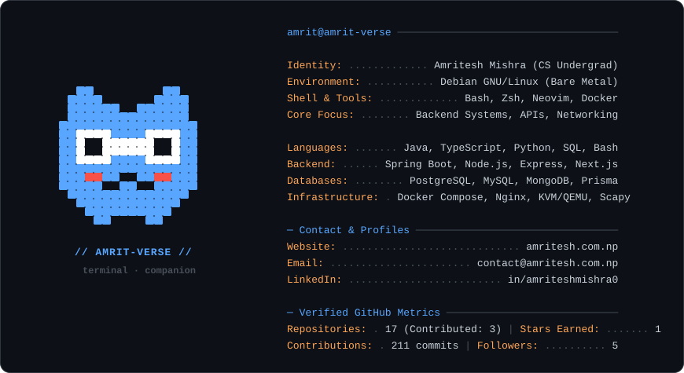

  <picture>
    <source media="(prefers-color-scheme: dark)" srcset="dark_mode.svg">
    <source media="(prefers-color-scheme: light)" srcset="light_mode.svg">
    
  </picture>

### About Me

I’m Amritesh — a Computer Science Engineering student focused on backend architecture, Linux systems, and distributed web services. A daily Debian user, I build platforms using Java (Spring Boot), TypeScript/Next.js, and Python.

I care about what happens below the UI layer: multi-container orchestration with Docker, database schema design & indexing, network packet analysis with Scapy, and writing resilient REST APIs with strict runtime validation.

---

### Featured Projects

| Project | Stack | Overview |
| :--- | :--- | :--- |
| **[JSR Dealership Platform](https://github.com/amrit-verse/JSR)** | Next.js 16, Prisma, PostgreSQL, Auth.js | Production inventory management & dealership platform for Jay Shree Ram Bike Point featuring full-text search, role-based authorization, and Playwright E2E coverage. |
| **[Network Packet Sniffer](https://github.com/amrit-verse/sniffer)** | Python, Scapy, Rich | Lightweight live traffic packet sniffer with protocol filtering, Rich terminal visualization, and PCAP/CSV export for network security auditing. |
| **[Library Management Backend](https://github.com/amrit-verse/library-management-system)** | Java, Spring Boot, MySQL, Docker | RESTful library service with request payload validation constraints, checkout workflows, and Docker Compose containerization. |
| **[ShopEase eCommerce](https://github.com/amrit-verse/shopease)** | React, Node.js, Express, MongoDB, Nginx | Modular full-stack store with custom Zod endpoint shielding, stateless JWT auth in HTTP-only cookies, and an Nginx reverse proxy. |
| **[Security Vulnerability Lab](https://github.com/amrit-verse/secure-coding-review)** | Python, Static Analysis, Bandit | Vulnerability analysis repository examining common web flaws (injection, broken auth), exploit demonstrations, and secure remediation patches. |

---

### Dev Environment & Toolkit

- **Host OS**: Debian GNU/Linux 12 (bare metal)
- **Languages**: Java, TypeScript, JavaScript, Python, SQL, Bash
- **Backend & Web**: Spring Boot, Node.js, Express.js, Next.js (App Router), React
- **Data & Storage**: PostgreSQL (Neon), MySQL, MongoDB (Atlas), Prisma ORM
- **Infrastructure & Systems**: Docker, Docker Compose, Nginx, KVM/QEMU, Linux Systemd, Wireshark, Git

---

### Connect

- **Website**: [amritesh.com.np](https://amritesh.com.np)
- **LinkedIn**: [linkedin.com/in/amriteshmishra0](https://www.linkedin.com/in/amriteshmishra0)
- **Email**: [contact@amritesh.com.np](mailto:contact@amritesh.com.np)
